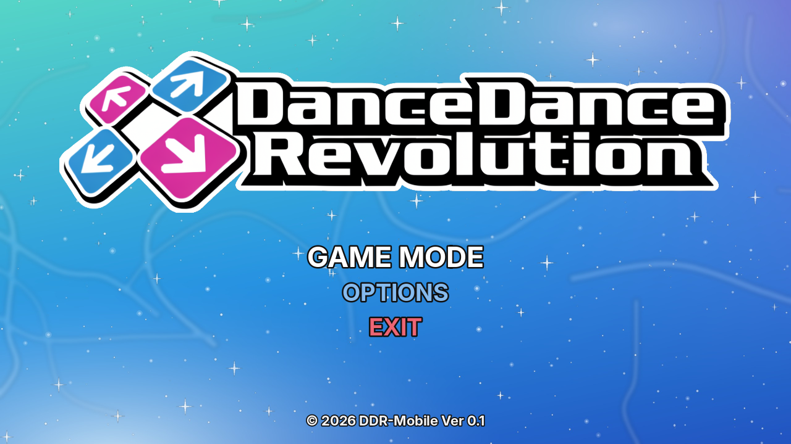
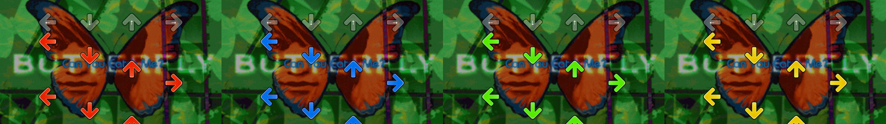
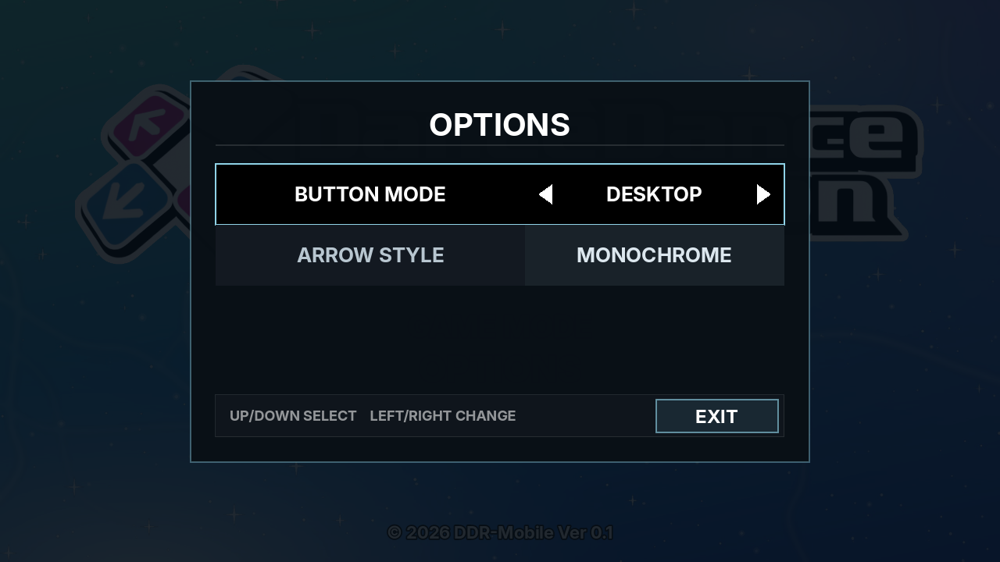

# DDR-Mobile

English | [简体中文](README.zh-CN.md)

A four-lane rhythm game inspired by [StepMania](https://github.com/stepmania/stepmania), built with Godot and GDScript for mobile touchscreens, with keyboard support. Choose a song and difficulty, tap the corresponding directions to the music, and review your performance on the results screen.

> This is an independently created, unofficial project and is not affiliated with Dance Dance Revolution, StepMania, or their respective rights holders.

## Screenshots

| Title screen | Gameplay |
|:---:|:---:|
|  |  |



*Title, gameplay, and options screens. The gameplay image uses example notes.*

## Features

- Four-lane touch and keyboard input, including hold notes.
- Browse songs by release, select difficulties, and preview audio.
- Multiple timing judgments, combos, life gauge, and results.
- Adjust sync offset, arrow style, and scroll direction; keep track of played songs.
- Read a subset of the `dance-single` format in SM, SSC, and DWI charts. The parser is not a complete StepMania format implementation, and charts containing unsupported content may not appear.

## Getting Started

### Requirements

- Godot 4: the project configuration specifies **4.7** and the GL Compatibility renderer.
- To export for Android, configure the Android SDK, JDK, and export templates as described in Godot's Android export documentation.

### Running from source

1. Clone the repository and import the root `project.godot` in the Godot project manager.
2. On first import, wait for the assets to be imported, then run the main scene (`main.tscn`).
3. Play using the touchscreen or the **← ↓ ↑ →** arrow keys.

### Adding songs

The `assets/songs/` directory is ignored by Git. You can [download the song pack from Baidu Netdisk](https://pan.baidu.com/s/1PuCBHjQPGRhTLKPZbqIJvw?pwd=8fkz) (extraction code: `8fkz`), extract it, and place the release directories under `assets/songs/` in the project root. Create the directory first if it does not exist. Avoid introducing an extra directory level when extracting; the structure should match the example below. You are responsible for confirming the rights to use and distribute the songs, charts, and images.

The scanner expects the following structure:

```text
assets/songs/
└── Release name/
    └── Song name/
        ├── chart.sm        # .ssc or .dwi also supported
        ├── music.ogg       # .mp3 or .wav also supported
        ├── banner.png      # Song image
        └── background-bg.png
```

Each song must have importable audio, a song image, a background image whose filename ends in `-bg`, and at least one parseable, playable chart to appear in the song list. Supported image formats are PNG, JPG, JPEG, and WebP. After adding files, wait for Godot to finish importing them; when exporting, also ensure the chart text files are included in the export package. The song list will be empty if the directory is missing.

## Project Structure

- `main.tscn` / `main.gd`: main scene, game state, and gameplay.
- `scripts/`: song catalog, chart parsing, song selection, and UI logic.
- `assets/`: UI assets and local song resources.
- `tests/`: GDScript tests.
- `export_presets.cfg`: Godot export settings; check the package name, target architectures, and signing settings before use.

## Copyright and Distribution

This repository does not yet provide a license for the project code; do not assume that the code or assets are open source. The project uses third-party assets, notably the StepMania artwork documented in `assets/stepmania/README.md`, whose specific licensing and redistribution permissions remain to be verified. Rights to songs, charts, covers, title images, and other assets must also be checked individually. Use and distribute only content for which you have appropriate permission.

Before publishing the repository or distributing an install package, review all tracked files and Git history for signing keys, build artifacts, and third-party assets, and choose and add an appropriate license. This project does not grant rights to use any music.
