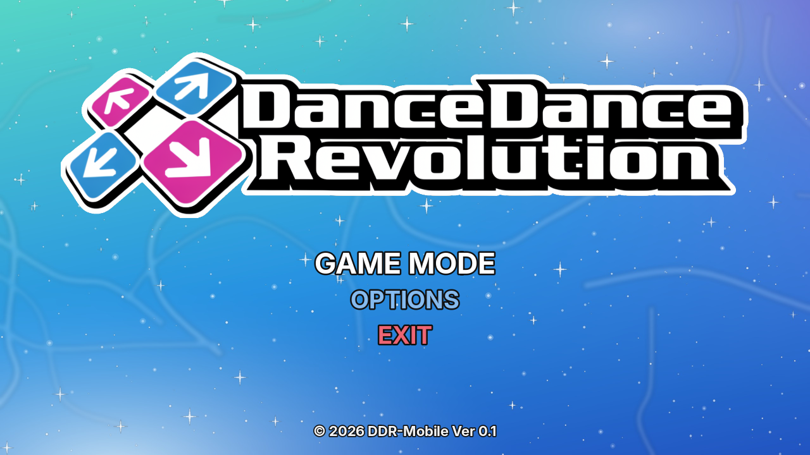
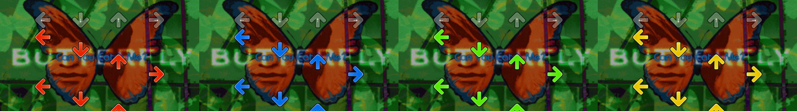
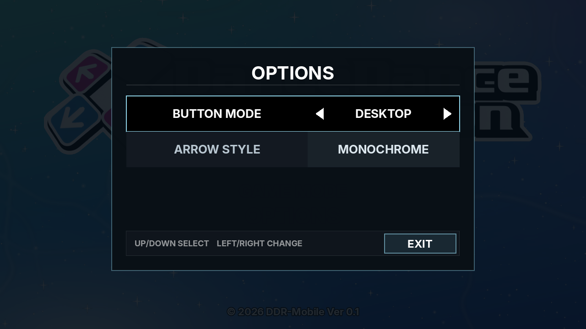

# DDR-Mobile

[English](README.md) | 简体中文

一个受 [StepMania](https://github.com/stepmania/stepmania) 启发、使用 Godot 和 GDScript 制作的四轨节奏游戏，面向移动设备的触屏操作，也可以使用键盘游玩。选择歌曲和难度，跟随音乐点击对应方向，并在结算画面查看成绩。

> 本项目是独立制作的非官方项目，与 Dance Dance Revolution、StepMania 及其权利人没有官方关联。

## 游戏截图

| 标题画面 | 游戏画面 |
|:---:|:---:|
|  |  |



*标题、游戏画面及选项界面；游戏画面使用示例音符展示。*

## 功能

- 四轨触屏与键盘输入，支持长按音符。
- 按版本浏览歌曲、选择难度和试听片段。
- 多级时机判定、连击、生命值和成绩结算。
- 调整同步偏移、箭头样式和滚动方向；记录已玩歌曲。
- 读取 SM、SSC 和 DWI 谱面的部分 `dance-single` 格式。解析器并非完整的 StepMania 格式实现，包含不支持内容的谱面可能不会显示。

## 开始使用

### 环境

- Godot 4：项目配置声明了 **4.7** 和 GL Compatibility 渲染器。
- 要导出 Android 版本，还需要按照 Godot 的 Android 导出文档配置 Android SDK、JDK 和导出模板。

### 从源码运行

1. 克隆仓库，用 Godot 项目管理器导入根目录下的 `project.godot`。
2. 首次导入时等待资源导入完成，然后运行主场景（`main.tscn`）。
3. 使用触屏或键盘方向键 **← ↓ ↑ →** 游玩。

### 添加歌曲

歌曲目录 `assets/songs/` 被 Git 忽略。可以从[百度网盘下载歌曲包](https://pan.baidu.com/s/1PuCBHjQPGRhTLKPZbqIJvw?pwd=8fkz)（提取码：`8fkz`），解压后将其中的版本目录放到项目根目录的 `assets/songs/` 下；如果该目录不存在，请先创建。注意避免解压后多出一层目录，确保目录结构与下面的示例一致。请自行确认歌曲、谱面和图片的使用及分发权限。

扫描结构如下：

```text
assets/songs/
└── 版本名称/
    └── 歌曲名称/
        ├── chart.sm        # 也可使用 .ssc 或 .dwi
        ├── music.ogg       # 也可使用 .mp3 或 .wav
        ├── banner.png      # 歌曲图片
        └── background-bg.png
```

每首歌须有可导入的音频、歌曲图片、文件名以 `-bg` 结尾的背景图，以及至少一个可解析且可玩的谱面，才会出现在选曲列表中。支持的图片格式为 PNG、JPG、JPEG 和 WebP。添加文件后请等待 Godot 完成导入；导出时还需确保谱面文本文件被包含在导出包中。目录缺失时歌曲列表会为空。

## 项目结构

- `main.tscn` / `main.gd`：主场景、游戏状态与玩法。
- `scripts/`：歌曲目录、谱面解析、选曲和界面等逻辑。
- `assets/`：界面素材及本地歌曲资源。
- `tests/`：GDScript 测试。
- `export_presets.cfg`：Godot 导出配置；使用前请检查包名、目标架构及签名设置。

## 版权与发布

本仓库尚未提供项目代码许可证，不能假定代码或素材已获开源授权。项目使用了第三方素材；特别是 `assets/stepmania/README.md` 中记录的 StepMania 美术资源，其具体授权和再分发权限尚待核实。歌曲、谱面、封面、标题图及其他素材也需要分别确认权利。请仅使用和分发已取得适当授权的内容。

公开仓库或发布安装包前，请审查所有跟踪文件和 Git 历史中的签名密钥、构建产物及第三方素材，并自行选择和添加适用的许可证。本项目不提供音乐内容的使用授权。
